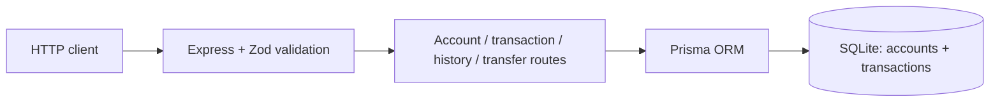

# LedgerLite

A transaction ledger API for creating accounts, posting credits and debits, transferring funds, and querying balances and history. Built as a backend assessment, with atomic money movement and database-enforced integrity.

**Stack:** TypeScript · Express 5 · Prisma 6 · SQLite · Zod · Vitest · Supertest

## Requirements

Node.js 24.x recommended; supported versions: 22.x (>=22.13), 24.x, or >=26 (see `package.json`). npm and curl are used below. No database server is required.

## Installation

```sh
npm ci
```

## Configuration

Run from the repository root; preserve any existing `.env`:

```sh
cp -n .env.example .env
npm run db:generate
npm run db:migrate
```

Defaults: `DATABASE_URL="file:./dev.db"`, `HOST="127.0.0.1"`, `PORT=3000`. The database is `prisma/dev.db`. No credentials are required. If port 3000 is occupied, set `PORT=3217` in `.env` and update `BASE_URL` below.

## Run locally

```sh
npm run build
npm start
```

Use `npm run dev` for development with automatic restarts. Keep the server running while trying the examples.

## Key features

- **Atomic mutations:** balance updates and ledger entries commit together; transfers include both accounts and both entries.
- **Duplicate prevention:** a unique `(account_id, reference_id)` constraint prevents repeated financial effects; duplicates return `409`.
- **Concurrency-safe debits:** conditional database updates prevent overdrafts, including concurrent requests through independent clients.
- **Immutable history through the API:** no transaction update/delete routes; reads support type filtering, bounded pagination, and latest-first ordering.

## Architecture



## Design decisions

- **Integer money storage:** persist cents; accept and return major-unit JSON numbers with at most two decimal places. Amounts and balances are capped at 21,474,836.47.
- **Database enforcement:** foreign keys, uniqueness, and SQL CHECK constraints complement input validation. Use `db:migrate`; `prisma db push` does not preserve the custom checks.
- **Small, local scope:** feature modules share validation and consistent JSON errors. No frontend or authentication; access control is required before public financial use.

## Try the API

In a second terminal, create an account and capture its generated ID using Node.js:

```sh
BASE_URL=http://127.0.0.1:3000
ACCOUNT_ID=$(curl -fsS "$BASE_URL/accounts" \
  -H 'Content-Type: application/json' -d '{"name":"Main account"}' \
  | node -pe 'JSON.parse(require("fs").readFileSync(0,"utf8")).data.id')

curl -fsS "$BASE_URL/transactions" -H 'Content-Type: application/json' \
  -d "{\"account_id\":\"$ACCOUNT_ID\",\"type\":\"credit\",\"amount\":100,\"reference_id\":\"deposit-1\"}"
curl -fsS "$BASE_URL/transactions" -H 'Content-Type: application/json' \
  -d "{\"account_id\":\"$ACCOUNT_ID\",\"type\":\"debit\",\"amount\":30,\"reference_id\":\"purchase-1\"}"
curl -fsS "$BASE_URL/accounts/$ACCOUNT_ID/balance"
curl -fsS "$BASE_URL/accounts/$ACCOUNT_ID/transactions?type=debit&page=1&limit=20"
```

The balance is `70`; filtered history contains one debit. Repeating `deposit-1` for that account returns `409 DUPLICATE_REFERENCE` without changing its balance. Successful responses use `{ "data": ... }`; errors use `{ "error": { "code": ..., "message": ... } }`.

## Endpoints

| Method | Path | Purpose |
|---|---|---|
| POST | `/accounts` | Create an account with zero balance |
| GET | `/accounts/:accountId/balance` | Read the current balance |
| POST | `/transactions` | Post a credit or debit |
| GET | `/accounts/:accountId/transactions` | Filter and paginate history |
| POST | `/transfers` | Transfer funds atomically between accounts |

## Verification

```sh
npm test
npm run typecheck
npm run build
npm run db:validate
```

**Verified: 106 tests passed across six files; zero failures.** Tests use real temporary SQLite databases and the checked-in migration. Coverage includes decimal precision, duplicate races, concurrent debits/transfers, immutable API records, database constraints, and injected insert failures that verify complete rollback. Type checking, build, and schema validation also pass. Node may emit an experimental SQLite warning from the test helper.

## Documentation

- [API reference and transfer examples](docs/API.md)
- [Assumptions and limitations](docs/ASSUMPTIONS.md)
- [Original assignment](docs/ASSIGNMENT_SOURCE.md)
- [Implementation plan and verification record](docs/IMPLEMENTATION_PLAN.md)
